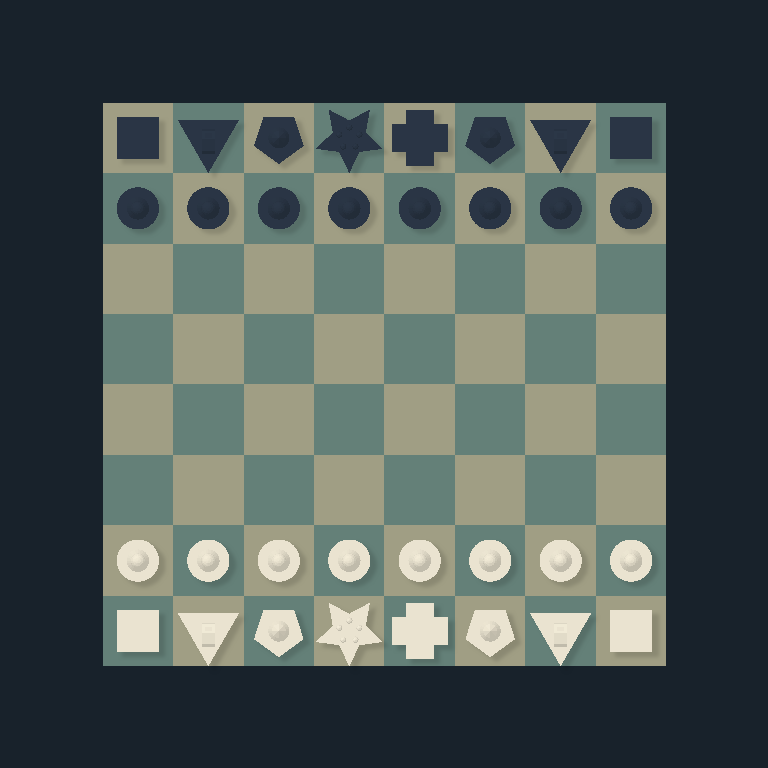

# Chessmate · Duke Robotics

A runnable perception demo for the Duke chess robotics project. It renders solid three-section pieces, captures the displayed RGB pixels, reconstructs the board independently, and passes the detected position to Stockfish. No ROS, Gazebo, external AI API, or robot movement is involved.



## Previously deployed demo

**[Open Chessmate](https://chessmate-duke-robotics.onrender.com)** — hosted on Render. Friends can use it with your Mac turned off; each browser receives an independent board. The free service can take 50 seconds or more to wake after inactivity, and board state is ephemeral.

Public verification passed: starting position, e2e4, and empty-board image detection all scored 64/64; Stockfish returned a move from the detected position; independent sessions and frame ownership checks passed. See [hosted test evidence](artifacts/hosted_report.json).

## Start here

This workspace already contains an installed `.venv`, a fitted template model, and a project-local Apple Silicon Stockfish 18 binary. Run:

```bash
cd chess_vision_poc
./run.sh
```

The script starts the server and opens **http://127.0.0.1:8765** in your default browser. If the server is already running, open that address directly. Stop it with Ctrl+C in its terminal. To run without opening a browser:

```bash
.venv/bin/python -m chess_vision.app
```

For a fresh checkout (Python 3.11 or newer; verified here with Python 3.12 on Apple Silicon):

```bash
cd chess_vision_poc
python3 -m venv .venv
source .venv/bin/activate
python -m pip install -r requirements.txt
python -m chess_vision.train  # optional if models/templates.npz is present
python -m chess_vision.app --open
```

Use `--port 8766` if another application occupies the default port. The development server binds only to loopback. Each visitor gets an independent board and private capture history using a signed, HTTP-only session cookie. Tabs in the same browser profile share that visitor's board. State is held in memory and resets on server restart or after two hours of inactivity; up to 256 recent visitor sessions are retained. Cloud deployment instructions are in [DEPLOYMENT.md](DEPLOYMENT.md).

## Try the complete workflow

1. Click **Detect Board**. The starting position should show **64/64**, 16 white pieces, and 16 black pieces.
2. Click **e2**, then **e4**. Detect again, or turn on **Auto Detect**. The predicted e2 square becomes empty and e4 becomes `P`.
3. Click **Suggest Best Move**. This captures a fresh frame, runs detection, validates it, and queries Stockfish. The UCI move, SAN, source, and destination appear; the board highlights the recommendation without playing it.
4. Switch to **Edit**. Choose free move, place, or remove. Select piece type and color, then click squares. **Clear Board** switches to Edit automatically. **Reset Board** restores the standard position while retaining the current mode.
5. Adjust the camera tilt to see the physical base/cube/top stack. Open **Debug image** to inspect the rectified pixels and labels. **Predictions** lists all 64 classifications, confidence, and overlap.

In Play mode, python-chess validates moves, captures, castling, en passant, and promotion. Select a promotion piece before moving a pawn onto its last rank. Selecting a piece outlines legal destinations. Click the selected square again to deselect it.

Free edits clear castling rights, en passant rights, and move history. Set the side to move in Edit. To specify complete metadata, load a full FEN in Edit and then switch to Play. Invalid edited configurations remain available for perception experiments, but cannot enter Play or Stockfish analysis.

## Physical geometry

The base outlines and plate height use Eric’s [Fusion STEP measurements](../models/chessbot/meshes) on a 50 mm square. The grip and upper pieces use the demo geometry. The Fusion [top-view renders](../models/chessbot/renders) are held out of fitting. The regression check segments their silhouettes, scales them to the CAD widths, and tests all six in both synthetic piece colors.

Every piece consists of actual filled 3D surfaces, with depth-buffered visibility. The model has no identification text, printed marks, or decals.

| Piece | Solid bottom base | Upper geometry |
| --- | --- | --- |
| Pawn | Circle | Tapered neck and sphere |
| Rook | Square | Square turret with four raised crenellations |
| Knight | Triangle | Extruded asymmetric horse profile, muzzle, and ear |
| Bishop | Pentagon | Tapered body and pointed mitre |
| Queen | Five-point star | Flared crown and five crown tips |
| King | Plus sign | Crown, stem, and cross |

The middle cube is exactly **0.30 × 0.30 × 0.30** for all types and both colors. A square width is 1.0; the base height is 0.10, and the cube spans z = 0.10 to 0.40. White pieces use warm ivory material and black pieces use blue-black material. Bases extend beyond the upper geometry where practical. Overhead images include the visible projection of every section; oblique images include occlusion and the displacement of elevated geometry.

The renderer is a small CPU 3D rasterizer in `render.py`, using an orthographic camera, a depth buffer, directional diffuse shading, and approximate soft ground shadows. Ground shadows use displaced base footprints, not a full physical shadow map. The illumination slider scales piece-material illumination; the board retains fixed palette colors. Geometry is polygonal, especially the small crown tips. This is a synthetic imaging prototype, not a manufacturing CAD model or a physically based renderer. The geometry has not been checked for print tolerances, gripper clearance, stability, or manufacturability.

## Recognition method and information boundary

The model is a **synthetic-template classifier**, not a pretrained CNN. This was chosen because the six custom silhouettes are deliberately separated and a reliable, inspectable baseline can be fitted locally without a large training job.

```text
Controller ──→ 3D renderer ──→ RGB PNG ──→ browser canvas
                                             │
                                    canvas.toDataURL()
                                             │
                       Detector(image_pixels, camera_corners)
                                             │
                              predicted 8×8 matrix + FEN
                                             │
                     post-inference comparison with controller
                                             │
                    validation + metadata ──→ optional Stockfish
```

`vision.py` imports neither the renderer, geometric models, nor game controller. Its inference method accepts only an RGB array and calibration. Calibration contains the four outer board-plane corners in a8/h8/h1/a1 order and image dimensions; it contains no object identities or piece locations. This PoC assumes calibration is supplied, rather than detecting board corners itself.

Inference rectifies the board plane with OpenCV, extracts each square's pixels, segments the two known material ranges, and compares the complete projected foreground mask with fitted synthetic masks using soft intersection-over-union. Piece color comes from the pixels. Empty squares use an occupancy threshold. A one-pixel cell rim is excluded to avoid background interpolation at the outer board edge.

Training renders 96 scenes at four camera tilts (0°, 12°, 24°, 36°) and 24 piece rotations (15° increments), producing **1,728 templates**. Labels are used during training only. The saved model is `models/templates.npz`; fitting is reproducible with:

```bash
.venv/bin/python -m chess_vision.train
```

The board plane is rectified; the pieces' elevated geometry is not flattened away. Their upper structures can mask their bases or cross square boundaries at steep angles. Templates include the combined projection. They do not assume an unobstructed base contour. The template model and evaluation share this renderer and material palette; measured synthetic accuracy is not evidence of real-camera accuracy.

Confidence is an uncalibrated heuristic combining template overlap with the margin over the second-best class. It is not a probability, and an empty prediction can still be wrong under poor illumination. Warnings identify weak/ambiguous occupied-square matches. Some correctly recognized stress cases still trigger conservative warnings.

`/api/detect` rejects board arrays and unexpected fields. The browser uploads the actual canvas PNG; interaction labels and move highlights are on a separate SVG layer and are excluded from that PNG. Frame IDs bind post-inference evaluation to the captured board revision. Tests also replace the pixels while holding the controller and calibration fixed, proving that predictions change with the image rather than the stored board.

## Verified results

Run the complete checks:

```bash
.venv/bin/python -m pytest -q
```

The original perception delivery passed **11 tests**. Hosting adds tests for visitor isolation, frame ownership, input validation, cookie flags, and branding. The image benchmark inside the suite contains **29 independently rendered scenarios**. All 14 required baseline scenarios achieved 64/64, and 27 of the 29 total scenarios achieved 64/64.

| Tested condition | Result |
| --- | --- |
| Starting position and each move in e2e4, e7e5, g1f3, b8c6 | 64/64 each |
| Empty board and a pawn capture | 64/64 each |
| Every piece/color on both tile colors; three random arrangements | 64/64 each |
| Castling, en passant, knight underpromotion, rendered after execution | 64/64 each |
| Unseen rotations of 23° and 137° | 64/64 each |
| 18° and 30° oblique views; rotated camera | 64/64 each |
| Piece illumination 0.9× and 1.1×; alternate palettes; shadows off | 64/64 each |
| Noise σ = 4 and σ = 12; combined moderate perturbations | 64/64 each |
| **60° tilt with 19° piece rotation** | **43/64** |
| **0.75× piece illumination** | **48/64** |

The steep-view failures include neighboring-square contamination and confusion between occluded silhouettes. The dim-light failure misses white pieces because they leave the configured material segmentation range. Both are visible in the saved artifacts. These are measured examples, not a guarantee over every position or angle. Scores include empty squares; the report also lists every incorrect square.

The browser smoke test passed actual clicks, four consecutive moves, Auto Detect, editing, FEN loading, underpromotion, a 30° view, the mobile layout, and real Stockfish analysis with no JavaScript errors. After e2e4/e7e5/g1f3/b8c6, the observed engine suggestion was `f1b5` / `Bb5`; engine moves may vary with search timing.

To run only the image benchmark and regenerate its report:

```bash
.venv/bin/python -m chess_vision.evaluate
```

To repeat the browser test while the server is running:

```bash
.venv/bin/python -m pip install -r requirements-dev.txt
.venv/bin/python tests/browser_smoke.py
```

The browser test uses the installed macOS Google Chrome by default, in an isolated headless profile. Set `CHROME_PATH` to another Chrome executable, or install Playwright Chromium with `.venv/bin/python -m playwright install chromium`. The test expects Stockfish to be available and resets the demo board.

Evidence:

- [Full score table and actual failure squares](artifacts/REPORT.md)
- [Machine-readable report](artifacts/report.json)
- [Browser test report](artifacts/browser_report.json)
- [Starting-position screenshot](artifacts/browser_initial.png)
- [Oblique view and annotated predictions](artifacts/browser_oblique_debug.png)
- [Detected-position Stockfish suggestion](artifacts/browser_move_suggestion.png)
- [60° failure input](artifacts/stress_60_degrees.png) and [annotated result](artifacts/stress_60_degrees_annotated.png)
- Every scenario's original PNG, annotated PNG, calibration, and prediction JSON are saved in `artifacts/`.

## Stockfish setup and refusal behavior

Stockfish is optional. Detection, editing, and legal play work without it. This workspace has an official Stockfish 18 Apple Silicon build at `bin/stockfish`, linked to its unpacked release. The release's GPL license, source, and documentation are retained in `bin/vendor/stockfish/`.

For another Mac, install it independently:

```bash
brew install stockfish
```

Or point to an existing engine before starting the server:

```bash
export STOCKFISH_PATH="/absolute/path/to/stockfish"
./run.sh
```

Discovery checks `STOCKFISH_PATH`, PATH, standard Homebrew locations, and then the project-local binary. The existing project-local binary is Apple Silicon-specific. No global Homebrew packages were installed by this project.

The engine receives the **detected** piece-placement FEN plus maintained turn, castling, en passant, and move-counter metadata. The controller placement is only a mismatch veto; it is never substituted into a failed detection. Uncertain predictions, mismatched placements, stale frames, invalid positions, and finished games are refused. Edited boards without valid kings may still be detected and displayed but cannot be analyzed by Stockfish.

## Modules and extension points

| File | Responsibility |
| --- | --- |
| `chess_vision/geometry.py` | Three-section solid meshes and identical cube |
| `chess_vision/render.py` | Camera, rasterization, shading, calibration, PNG output |
| `chess_vision/train.py` | Reproducible template fitting from synthetic pixels |
| `chess_vision/vision.py` | Pixel-only reconstruction and annotations |
| `chess_vision/game.py` | Chess rules, editing, post-inference evaluation |
| `chess_vision/engine.py` | Detected-position validation and Stockfish UCI |
| `chess_vision/app.py` | Local HTTP API and frame revision checks |
| `static/` | Browser interface and real canvas capture |
| `chess_vision/evaluate.py` | Automated rendered-image benchmark |
| `tests/` | Geometry/rules/boundary/engine tests and browser workflow |

An independent caller can use `Detector().detect(rgb_image, calibration)` without starting the app or constructing a game. Row 0 is rank 8; row 7 is rank 1. Columns are a through h. Symbols are `PNBRQK`, lowercase equivalents, and `.` for empty squares. `placement_fen` contains only the piece-placement field, not inferred game metadata.

Next work for a physical prototype: calibrate the real camera, model lens distortion, collect labeled images of printed pieces, replace or adapt material segmentation, and evaluate occlusion on real scenes. A learned image classifier could replace `vision.py` while preserving its pixel/calibration-only interface. ROS, Kinova control, grasp planning, automatic move execution, and real-camera recognition remain outside this delivered PoC.

## Primary references

- [python-chess core rules and Board validity](https://python-chess.readthedocs.io/en/latest/core.html)
- [python-chess UCI engine interface](https://python-chess.readthedocs.io/en/latest/engine.html)
- [OpenCV perspective transforms](https://docs.opencv.org/4.x/da/d54/group__imgproc__transform.html)
- [Official Stockfish release used locally](https://github.com/official-stockfish/Stockfish/releases/tag/sf_18)
- [Stockfish installation and usage](https://official-stockfish.github.io/docs/stockfish-wiki/Download-and-usage.html)
